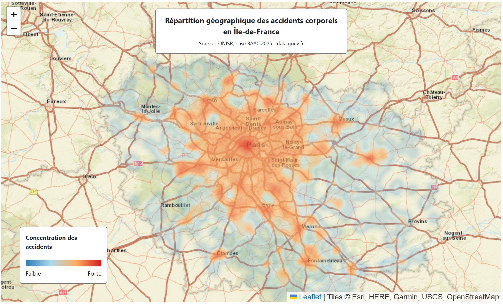
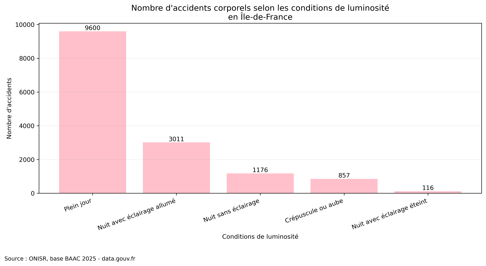

Projet : Analyse des accidents corporels de la circulation en Île-de-France (2025)
Ce projet a pour objectif d'étudier la répartition géographique des accidents corporels de la circulation en France à partir des données officielles de l'année 2025.

J'ai choisi de limiter mon analyse à la région Île-de-France pour faciliter l'exploration des données et leur représentation cartographique.

Pour réaliser ce travail, j'utilise Python et plusieurs bibliothèques permettant de nettoyer les données, de réaliser des calculs et de créer des visualisations.

Mon analyse comporte deux représentations :
- Une carte interactive permettant de visualiser les zones de concentration des accidents.
- Un graphique en barres permettant de comparer les accidents selon les conditions de luminosité.

1. Présentation des données
   
Les données utilisées proviennent de la base officielle des accidents corporels de la circulation routière, disponible sur le site data.gouv.fr.

J'utilise deux fichiers :
- caract-2025.csv : contient les caractéristiques des accidents, notamment la date, les conditions de luminosité et les coordonnées géographiques.
- lieux-2025.csv : contient les informations relatives aux lieux où les accidents se sont produits.

L'étude porte uniquement sur les accidents enregistrés en Île-de-France durant l'année 2025.

2. Cartographie des accidents en Île-de-France
   
Cette première visualisation est représente la répartition géographique des accidents corporels en Île-de-France en 2025.
J'ai choisi une carte de chaleur afin de visualiser les zones où les accidents sont les plus concentrés.
Les couleurs permettent de repérer les différentes intensités de concentration.

La carte permet de visualiser la répartition géographique des accidents corporels en Île-de-France en 2025.

Les zones les plus rouge correspondent aux endroits où les accidents sont les plus concentrés.

On remarque notamment une concentration importante autour de Paris et de plusieurs zones urbaines de la région.

J'ai choisi une carte de chaleur car elle permet de représenter plusieurs accidents proches les uns des autres sans afficher une multitude de points superposés. Cette visualisation facilite donc l'identification des zones de concentration.

3. Comparaison des accidents selon les conditions de luminosité
   
Pour compléter la carte, j'ai choisi d'étudier les accidents selon les conditions de luminosité.

Cette analyse permet de comparer le nombre d'accidents survenus en plein jour, à l'aube ou pendant la nuit.

J'ai choisi un graphique en barres car il permet de comparer facilement les différentes catégories.

Le graphique présente le nombre d'accidents corporels selon les conditions de luminosité.
La catégorie "Plein jour" enregistre le plus grand nombre d'accidents avec 9 600 accidents.
À l'inverse, la catégorie "Nuit avec éclairage éteint" enregistre le moins d'accidents avec 116 accidents.
Cependant, le nombre d'accidents ne permet pas à lui seul de déterminer les conditions dans lesquelles le risque d'accident est le plus élevé. Pour cela, il faudrait également connaître le nombre de déplacements réalisés dans chaque condition. Mais une conclusion qui peut etre logique serait que lorsque un conducteur est en situation dite habituel il fait moins attention.

4. Application des règles de lisibilité
   
Pour améliorer la qualité de mes visualisations, j'ai appliqué plusieurs règles de lisibilité étudiées dans le support GoldenViz.
Ces règles permettent de rendre les graphiques plus simples à comprendre, de faciliter les comparaisons et d'éviter les informations inutiles.

Règle 7 : Étiquettes et graduations lisibles
J'ai choisi des titres explicites et des tailles de texte adaptées afin de faciliter la lecture de mes visualisations.

Règle 8 : Accessibilité des couleurs
J'ai choisi un dégradé de couleurs allant du bleu au rouge pour différencier les concentrations sur la carte. Pour le graphique en barres, j'ai utilisé une couleur unique afin de conserver une présentation simple et compréhensible.

Règle 9 : Étiquetage direct
J'ai affiché directement les valeurs au-dessus des barres de mon graphique afin de faciliter la lecture des résultats.

Règle 10 : Éviter le chartjunk
J'ai évité les effets décoratifs inutiles et privilégié un fond de carte clair pour faire ressortir les informations importantes.

Règle 11 : Trop de catégories
J'ai limité mon analyse à 5 conditions principales de luminosité afin de faciliter la comparaison des résultats.

Règle 12 : Trier les barres catégorielles
J'ai classé les barres de la catégorie ayant le plus d'accidents à celle qui en a le moins afin de faciliter les comparaisons.

Règle 13 : Surimpression dans les nuages de points
J'ai utilisé une carte de chaleur pour éviter la superposition de nombreux points géographiques et mieux visualiser les zones de concentration.

Règle 14 : Précision décimale
J'ai utilisé des nombres entiers pour représenter le nombre d'accidents car les décimales ne sont pas nécessaires pour cette analyse.

Règle 16 : Économie visuelle
J'ai choisi deux visualisations complémentaires plutôt que de regrouper toutes les informations dans un seul graphique. Cela permet de conserver un message clair pour chaque représentation.
